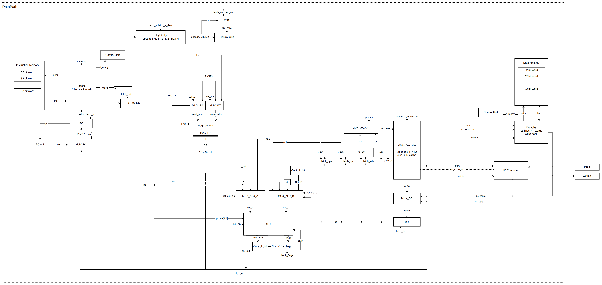
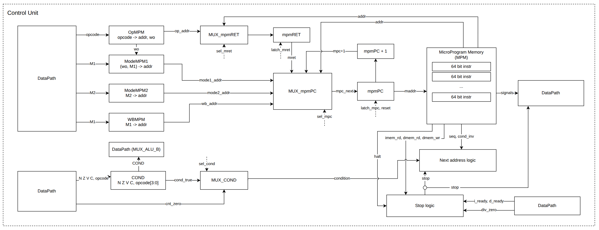

# Архитектура Компьютера. Лабораторная работа 4

Ефимов Антон Дмитриевич P3218

## Вариант

`alg | cisc | harv | mc | stream | mem | cstr | cache | alg2`

| Особенность        | Значение | Что это значит в работе                                                    |
|--------------------|----------|----------------------------------------------------------------------------|
| Язык               | `alg`    | C-подобный язык с математическими выражениями и функциями                  |
| Архитектура        | `cisc`   | команды «регистр-память» переменной длины, `push` и `pop` с переменным числом операндов |
| Организация памяти | `harv`   | раздельные память команд и память данных                                   |
| Control Unit       | `mc`     | микропрограммное управление, микрокод в отдельной памяти MPM               |
| Ввод-вывод         | `stream` | поток символов из заранее заданного буфера                                 |
| Ввод-вывод ISA     | `mem`    | порты отображены в память данных: `0x80` ввод, `0x84` вывод                |
| Строки             | `cstr`   | строка заканчивается нулём, один символ на машинное слово                  |
| Усложнение         | `cache`  | кеш команд и кеш данных перед обеими памятями                              |
| Алгоритмы          | `alg2`   | `collatz_length`, `infix_to_rpn`                                           |

Реализация на Go. Полная спецификация лежит в папке [docs](docs): [язык](docs/language.md), [память и система команд](docs/memory-isa.md), [модель процессора](docs/processor.md). В этом отчёте приведено главное.

## Язык программирования

### Синтаксис

Язык с C-подобным синтаксисом. Расширенная форма Бэкуса-Наура: `{ X }` повторение, `[ X ]` необязательная часть.

```ebnf
<program>        ::= { <top_item> }
<top_item>       ::= <const_decl> | <func_decl> | <statement>

<const_decl>     ::= "const" <ident> "=" <const_expr> ";"
<func_decl>      ::= "func" <ident> "(" [ <params> ] ")" <block>
<params>         ::= "auto" <ident> { "," "auto" <ident> }

<block>          ::= "{" { <statement> } "}"
<statement>      ::= <var_decl> ";" | <if_stmt> | <while_stmt> | <for_stmt>
                   | <return_stmt> | <block> | <expression> ";"

<var_decl>       ::= "auto" <ident> [ "=" <expression> ]
                   | "auto" <ident> "[" <const_expr> "]"
<if_stmt>        ::= "if" "(" <expression> ")" <block> [ "else" ( <block> | <if_stmt> ) ]
<while_stmt>     ::= "while" "(" <expression> ")" <block>
<for_stmt>       ::= "for" "(" [ <for_init> ] ";" [ <expression> ] ";" [ <expression> ] ")" <block>
<for_init>       ::= <var_decl> | <expression>
<return_stmt>    ::= "return" [ <expression> ] ";"

<expression>     ::= <assignment>
<assignment>     ::= <lvalue> "=" <assignment> | <logic_or>
<logic_or>       ::= <logic_and> { "||" <logic_and> }
<logic_and>      ::= <bit_or> { "&&" <bit_or> }
<bit_or>         ::= <bit_and> { "|" <bit_and> }
<bit_and>        ::= <equality> { "&" <equality> }
<equality>       ::= <relational> { ( "==" | "!=" ) <relational> }
<relational>     ::= <additive> { ( "<" | "<=" | ">" | ">=" ) <additive> }
<additive>       ::= <multiplicative> { ( "+" | "-" ) <multiplicative> }
<multiplicative> ::= <unary> { ( "*" | "/" | "%" ) <unary> }
<unary>          ::= ( "-" | "!" | "~" ) <unary> | <postfix>
<postfix>        ::= <primary> { "[" <expression> "]" }
<primary>        ::= <number> | <char> | <string> | <ident> | <call> | "(" <expression> ")"
<call>           ::= <ident> "(" [ <expression> { "," <expression> } ] ")"
<lvalue>         ::= <ident> | <postfix> "[" <expression> "]"
<const_expr>     ::= <expression>   (* вычислимое при трансляции *)

<ident>          ::= <letter> { <letter> | <digit> }
<number>         ::= <digit> { <digit> } | "0x" <hex_digit> { <hex_digit> }
<char>           ::= "'" ( <symbol> | <escape> ) "'"
<string>         ::= '"' { <symbol> | <escape> } '"'
<escape>         ::= "\" ( "n" | "t" | "0" | "\" | "'" | '"' )
```

- Комментарий начинается с `//` и идёт до конца строки.
- Зарезервированные слова: `auto`, `const`, `func`, `if`, `else`, `while`, `for`, `return`.
- Встроенные функции: `in()`, `out(e)`, `add64(r, a, b)`, `sub64(r, a, b)`.

### Стратегия вычислений

- Стратегия строгая (энергичная), вызов по значению.
- Аргументы функций и операнды бинарных операторов вычисляются слева направо.
- `&&` и `||` вычисляются лениво: правый операнд пропускается, если результат уже известен.
- Любое выражение возвращает значение. Присваивание тоже выражение (`a = b = 0`). В присваивании сначала вычисляется правая часть, затем адрес левой.
- Функция без `return` возвращает `0`.
- Операторы верхнего уровня выполняются сверху вниз, после последнего процессор останавливается. Функции `main` нет.

### Области видимости

- Область видимости лексическая, блочная. Имя доступно только после объявления.
- Функции видны во всей программе: возможны рекурсия и вызов функций, объявленных ниже.
- Переменные верхнего уровня глобальные. Параметры и переменные в теле функции локальные, каждый вызов получает свою копию.
- Локальная переменная может перекрывать глобальную. Повторное объявление в одном блоке считается ошибкой.

### Типизация. Виды литералов

- Один тип `auto`: 32-битное знаковое целое. Числа, символы, логические значения и адреса не различаются.
- Арифметика по модулю 2³². `/` округляет к нулю, `%` имеет знак делимого. Деление на ноль останавливает процессор.
- Целые литералы: `42`, `0x2A`. Символьные: `'h'` равен 104, есть escape-последовательности `\n`, `\t`, `\0`, `\\`, `\'`, `\"`.
- Строковый литерал `"hello"` размещается в памяти данных как C-строка, его значение равно адресу первого символа.
- Константа `const N = 32;` вычисляется при трансляции и подставляется в код. Память под неё не выделяется.
- Массив `auto buf[N];` занимает `N` слов. Имя массива означает адрес первого элемента. `e[i]` обращается к слову по адресу `e + i * 4`.

### Встроенные функции

| Функция           | Действие                                                                    |
|-------------------|-----------------------------------------------------------------------------|
| `in()`            | читает один символ из потока ввода                                          |
| `out(e)`          | выводит символ с кодом, равным младшему байту `e`                           |
| `add64(r, a, b)`  | складывает 64-битные числа по адресам `a` и `b`, сумму пишет по адресу `r`  |
| `sub64(r, a, b)`  | вычитает число по адресу `b` из числа по адресу `a`, разность пишет в `r`   |

64-битное число хранится в двух словах: младшее по меньшему адресу (`auto x[2];`). Строки обрабатываются только функциями на самом языке.

### Пример программы

```c
func print_str(auto s) {
    auto i = 0;
    while (s[i] != '\0') { // печатаем до нуля в конце строки
        out(s[i]);
        i = i + 1;
    }
}

print_str("Hello, world!\n");
```

## Организация памяти

- Машинное слово занимает 32 бита, порядок байт little-endian.
- Гарвардская архитектура: память команд и память данных по 64 КиБ, обе однопортовые.
- Адресация байтовая. Обращения выполняются только словами по адресам, кратным 4.
- Обращения к обеим памятям идут через кеш: I-cache для команд, D-cache для данных.

```text
       Память команд                          Память данных
+------------------------------+      +--------------------------------+
| 0x0000 : код верхнего уровня |      | 0x0000..0x007F : не исп.       |
|    ...                       |      | 0x0080 : порт ввода            |
|        : halt                |      | 0x0084 : порт вывода           |
|        : функция 1           |      | 0x0088 : глобальные переменные |
|    ...                       |      |        : глобальные массивы    |
|        : функция 2           |      |        : строковые литералы    |
|    ...                       |      |    ...   свободная память      |
+------------------------------+      |        ^ стек растёт вниз      |
                                      | 0xFFFC : дно стека             |
                                      +--------------------------------+
```

### Регистры

| Регистр     | Назначение                                             |
|-------------|--------------------------------------------------------|
| `R0`        | результат функции, вспомогательный                     |
| `R1`..`R7`  | временные значения выражений                           |
| `FP`        | указатель кадра функции (код 8)                        |
| `SP`        | указатель стека (код 9), начальное значение `0x10000`  |
| `PC`        | счётчик команд (неявно)                                |
| `N Z V C`   | флаги (неявно)                                         |

### Отображение программы на память

- **Литералы.** Числовые и символьные всегда подставляются в команду непосредственной адресацией (`add R1, #5`). Строковые хранятся в статической памяти как C-строка: символ на слово, в конце `0`, строки идут друг за другом без промежутков.
- **Константы.** Подставляются как непосредственные значения, память не выделяется.
- **Переменные.** Всегда в памяти, на регистры не отображаются. Глобальные и переменные блоков верхнего уровня лежат в статической памяти с адреса `0x88` и адресуются напрямую: `[0x008C]`. Параметры и локальные переменные лежат в кадре стека: `[FP+8]`, `[FP-4]`.
- **Порядок статических данных.** Сначала переменные, затем массивы, затем строковые литералы.
- **Выражения.** Регистры `R1`..`R7` образуют пул временных регистров, который используется как стек. Листья дерева (литералы, переменные) подставляются в команду напрямую. Если регистры кончились, левый операнд сохраняется в стек командой `push`.
- **Функции.** Аргументы кладутся в стек одной командой `push` с несколькими операндами, затем `call`. Результат возвращается в `R0`. Регистры сохраняет вызывающий код (caller-saved).
- **Прерываний нет:** ввод-вывод `stream` выполняется синхронно.

Кадр функции с `n` аргументами:

```text
| аргумент 1              |  FP + 8 + 4*(n-1)
| аргумент n              |  FP + 8
| адрес возврата          |  FP + 4
| сохранённый FP          |  FP + 0   <- FP
| локальная переменная 1  |  FP - 4
| временные значения      |           <- SP
```

### Порты и строка кеша

Порты `0x80`, `0x84` и первые два слова статических данных `0x88`, `0x8C` попадают в одну строку кеша (строка занимает 16 байт: `0x80`..`0x8F`). Это корректно. Адрес сначала проходит через MMIO Decoder, который направляет обращения к `0x80` и `0x84` в контроллер ввода-вывода, до кеша они не доходят. Обращения к `0x88` и `0x8C` идут в D-cache как обычно. При промахе кеш читает всю строку из памяти данных, а не из контроллера ввода-вывода, поэтому символ ввода при этом не теряется. Слова `0x80` и `0x84` внутри строки процессор через кеш никогда не читает. Это проверяет тест `TestPortsShareCacheLineWithData`.

## Система команд

- CISC, двухадресная, типа «регистр-память» (по образцу PDP-11 и VAX).
- Арифметика работает с памятью напрямую, оба операнда могут быть в памяти: `add [FP-4], #1`.
- Команды переменной длины: от 1 до нескольких слов. Каждое следующее слово выбирается отдельно с `PC ← PC + 4`.
- `push` и `pop` принимают от 1 до 255 операндов.
- Специальных команд ввода-вывода нет: `mov R1, [0x0080]`, `mov [0x0084], R1`.

### Режимы адресации

| Код | Запись     | Значение                      | Слов расширения |
|-----|------------|-------------------------------|-----------------|
| 0   | нет        | операнд отсутствует           | 0               |
| 1   | `Rn`       | регистр                       | 0               |
| 2   | `#value`   | непосредственное значение     | 1               |
| 3   | `[addr]`   | память по абсолютному адресу  | 1               |
| 4   | `[Rn]`     | память по адресу из регистра  | 0               |
| 5   | `[Rn+off]` | память по адресу `Rn + off`   | 1               |

### Кодирование команд

Первое слово команды:

```text
 31        24 23    20 19    16 15    12 11     8 7          0
+------------+--------+--------+--------+--------+------------+
|   opcode   |   M1   |   R1   |   M2   |   R2   |     N      |
+------------+--------+--------+--------+--------+------------+
```

`M1 R1` и `M2 R2` задают режим адресации и регистр первого и второго операндов. За первым словом идут слова расширения: сначала первого операнда, затем второго.

У `push` и `pop` в первом слове заполнены только `opcode` и число операндов `N`. Дальше идут `N` слов-описателей, каждое со своим словом расширения, если оно нужно. Режим и регистр в описателе стоят в тех же битах, что `M1 R1` в первом слове:

```text
 31        24 23    20 19    16 15                           0
+------------+--------+--------+------------------------------+
|     0      |  mode  |  reg   |              0               |
+------------+--------+--------+------------------------------+
```

Примеры:

```text
add  R1, R2            10111200
add  R1, #5            10112000 00000005
mov  [0x0084], #104    01302000 00000084 00000068
push R1, #5, [FP-8]    02000003 00110000 00200000 00000005 00580000 FFFFFFF8
```

### Набор инструкций

| Код            | Команды                                 | Действие                                    | Флаги     |
|----------------|-----------------------------------------|---------------------------------------------|-----------|
| `0x00`         | `halt`                                  | останов                                     | нет       |
| `0x01`         | `mov dst, src`                          | `dst ← src`                                 | нет       |
| `0x02`         | `push op1, ..., opN`                    | по порядку: `SP ← SP-4`, `mem[SP] ← opi`    | нет       |
| `0x03`         | `pop op1, ..., opN`                     | по порядку: `opi ← mem[SP]`, `SP ← SP+4`    | нет       |
| `0x10`, `0x11` | `add`, `sub`                            | `dst ← dst ± src`                           | `N Z V C` |
| `0x12`..`0x14` | `mul`, `div`, `rem`                     | умножение, деление, остаток                 | `N Z`     |
| `0x15`, `0x16` | `and`, `or`                             | побитовые И, ИЛИ                            | `N Z`     |
| `0x17`, `0x18` | `adc`, `sbc`                            | `dst ← dst ± src ± C` (двойная точность)    | `N Z V C` |
| `0x19`         | `cmp dst, src`                          | `dst - src`, результат не сохраняется       | `N Z V C` |
| `0x1A`, `0x1B` | `neg op`, `not op`                      | `op ← -op`, `op ← ~op`                      | `N Z V C`, `N Z` |
| `0x20`..`0x28` | `jmp jeq jne jlt jle jgt jge jcs jcc`   | переход по условию на флагах                | нет       |
| `0x31`..`0x36` | `seq sne slt sle sgt sge`               | `op ← 1`, если условие выполнено, иначе `0` | нет       |
| `0x40`         | `call op`                               | `SP ← SP-4`, `mem[SP] ← PC`, `PC ← op`      | нет       |
| `0x41`         | `ret`                                   | `PC ← mem[SP]`, `SP ← SP+4`                 | нет       |

Младшие четыре бита опкодов переходов и команд установки задают код условия (`jeq` это `0x21`, `seq` это `0x31`), поэтому условие для обеих групп вычисляет один блок `COND`. Младшие биты опкодов `add`..`not` совпадают с кодом операции АЛУ.

### Количество тактов

Одна микрокоманда занимает один такт. Время команды: `T = 2 + T1 + T2 + Tвып`, где 2 такта занимают `FETCH` и `DECODE`, `T1` и `T2` это выборка операндов, `Tвып` это выполнение.

| Режим      | `T1` (чтение) | `T1` (только адрес) | `T2` |
|------------|---------------|---------------------|------|
| нет, `Rn`  | 1             | 1                   | 1    |
| `#v`       | 2             | недопустим          | 2    |
| `[addr]`   | 4             | 2                   | 4    |
| `[Rn]`     | 3             | 1                   | 3    |
| `[Rn+off]` | 4             | 2                   | 4    |

| Команды                      | `Tвып`                        | Пример                                    |
|------------------------------|-------------------------------|-------------------------------------------|
| `add`..`sbc`, `neg`, `not`   | 2                             | `add R1, R2`: 6, `add [FP-4], #1`: 10     |
| `cmp`                        | 1                             | `cmp [FP+8], #0`: 9                       |
| `mov`, `seq`..`sge`          | 2                             | `mov [0x0084], #104`: 8                   |
| `jmp`..`jcc`                 | 1 (нет перехода), 2 (переход) | `jeq #label`: 6 или 7                     |
| `call`, `ret`                | 3                             | `call #f`: 8, `ret`: 7                    |
| `halt`                       | 1                             | 5                                         |
| `push op1, ..., opN`         | `Σ(4 + T1ᵢ) + 1`              | `push FP`: 10, `push R1, #5`: 16          |
| `pop op1, ..., opN`          | `Σ(7 + T1ᵢ) + 1`              | `pop FP`: 13                              |

«Только адрес» используется для приёмника команд `mov`, `seq`..`sge` и операндов `pop`: старое значение приёмника читать не нужно. Промах кеша добавляет 9 тактов ожидания, промах с вытеснением изменённой строки 19. Эти числа проверяет тест `TestTicksPerInstruction`.

## Транслятор

Интерфейс командной строки:

```text
translator <source> <out.bin> [<out.lst>]
```

- `source`: файл с программой на языке лабораторной.
- `out.bin`: бинарный файл с машинным кодом.
- `out.lst`: необязательный текстовый листинг.

Код транслятора: [internal/translator](internal/translator). Этапы трансляции:

1. **Лексер** ([lexer.go](internal/translator/lexer.go)) разбивает текст на лексемы: идентификаторы, ключевые слова, числа, символы, строки, знаки операций.
2. **Парсер** ([parser.go](internal/translator/parser.go)) строит AST рекурсивным спуском: каждому нетерминалу грамматики соответствует один метод. Все уровни бинарных операторов разбираются одним методом по таблице приоритетов.
3. **AST** ([ast.go](internal/translator/ast.go)) можно вывести в человекочитаемом виде: один узел на строку, вложенность показана отступом. Этот дамп проверяется в golden-тестах.
4. **Кодогенератор** ([codegen.go](internal/translator/codegen.go)) обходит AST и выдаёт команды с метками вместо адресов.
5. **Компоновка** ([translator.go](internal/translator/translator.go)) расставляет адреса (код верхнего уровня, `halt`, функции, статические данные с `0x88`), подставляет их в операнды и кодирует команды в слова.

Правила кодогенерации:

- Лист выражения подставляется в команду как операнд: литерал как `#value`, глобальная переменная как `[addr]`, локальная как `[FP+off]`.
- Остальные значения вычисляются в регистры пула `R1`..`R7`. Пример для `x = a + 5 * b`:

    ```text
    mov  R1, [FP-4]      ; R1 = a
    mov  R2, #5
    mul  R2, [FP-8]      ; R2 = 5 * b
    add  R1, R2
    mov  [0x0088], R1    ; x = R1
    ```

- `x = x + 1` даёт одну команду над памятью: `add [FP-4], #1`.
- `c = in()` и `out(c)` дают обычные `mov` с адресами портов: `mov [FP-8], [0x0080]`.
- Сравнение в условии даёт `cmp` и условный переход. Сравнение как значение даёт `cmp` и команду установки (`slt R1`).
- `&&` и `||` транслируются в условные переходы, которые обходят правый операнд.
- Перед вызовом функции занятые регистры пула сохраняются в стеке (`push R1`), после возврата восстанавливаются (`pop R1`).
- `add64(r, a, b)` разворачивается в `add` младших слов и `adc` старших. `mov` между ними флаги не меняет, поэтому перенос сохраняется.

### Формат машинного кода

Бинарный файл: сигнатура `LAB4`, размер образа команд в байтах, размер образа данных в байтах, образ памяти команд, образ памяти данных. Числа и слова записаны в порядке little-endian.

Листинг программы `hello` (память команд и начало памяти данных):

```text
; instruction memory
0000 - 02000001 00200000 00000088 - push #136
000C - 40200000 00000020 - call #0x0020
0014 - 10192000 00000004 - add SP, #4
001C - 00000000 - halt
; print_str
0020 - 02000001 00180000 - push FP
0028 - 01181900 - mov FP, SP
002C - 11192000 00000004 - sub SP, #4
0034 - 01582000 FFFFFFFC 00000000 - mov [FP-4], #0
0040 - 01115800 FFFFFFFC - mov R1, [FP-4]
0048 - 12112000 00000004 - mul R1, #4
0050 - 10115800 00000008 - add R1, [FP+8]
0058 - 01114100 - mov R1, [R1]
005C - 19112000 00000000 - cmp R1, #0
0064 - 21200000 000000A4 - jeq #0x00A4
...
00B8 - 41000000 - ret

; data memory
0088 - 00000048 - 'H'
008C - 00000065 - 'e'
...
00BC - 0000000A - '\n'
00C0 - 00000000 - '\0'
```

Адреса в памяти и адреса переходов печатаются в шестнадцатеричном виде, непосредственные значения и смещения в десятичном. Строка `"Hello, world!\n"` лежит в памяти данных с адреса `0x88` (136), в коде остаётся только её адрес.

## Модель процессора

Интерфейс командной строки:

```text
machine <code.bin> <input.txt> [--no-cache] [--log-limit N]
```

- `code.bin`: бинарный файл от транслятора.
- `input.txt`: файл с потоком ввода.
- `--no-cache`: отключить кеши, каждое обращение к памяти занимает 10 тактов.
- `--log-limit N`: оставить в журнале первые и последние `N/2` строк.

Вывод программы печатается в stdout, журнал и итоговая статистика в stderr. Код модели: [internal/machine](internal/machine).

Названия блоков и сигналов в коде и в тексте совпадают со схемой [docs/scheme-cisc.drawio](docs/scheme-cisc.drawio). Сплошные линии на схемах это данные и адреса, пунктирные стрелки это управляющие сигналы.

### DataPath



Регистры:

| Регистр         | Назначение                                                    | Сигнал записи          |
|-----------------|---------------------------------------------------------------|------------------------|
| `PC`            | адрес текущего слова в памяти команд                          | `latch_pc`             |
| `IR`            | первое слово команды: `opcode`, `M1`, `R1`, `M2`, `R2`, `N`   | `latch_ir`             |
| `IR.M1 R1`      | поле первого операнда, загружается из описателя `push` и `pop` | `latch_ir_desc`       |
| `EXT`           | слово расширения                                              | `latch_ext`            |
| `Register File` | `R0`..`R7`, `FP`, `SP`, один порт чтения и один порт записи   | `rf_wr`                |
| `OPA`, `OPB`    | значения первого и второго операндов, `OPA` затем результат   | `latch_opa`, `latch_opb` |
| `ADST`          | адрес приёмника в памяти                                      | `latch_adst`           |
| `AR`            | адрес второго операнда и адрес вершины стека                  | `latch_ar`             |
| `DR`            | слово, прочитанное из памяти данных или порта ввода           | `latch_dr`             |
| `flags`         | флаги `N Z V C`                                               | `latch_flags`          |
| `CNT`           | счётчик оставшихся операндов `push` и `pop`                   | `latch_cnt`, `dec_cnt` |

Мультиплексоры:

| Мультиплексор | Сигнал      | Входы                                                    |
|---------------|-------------|----------------------------------------------------------|
| `MUX_PC`      | `sel_pc`    | 0: `pc+4`, 1: `alu_out`                                  |
| `MUX_RA`      | `sel_ra`    | 0: `IR.R1`, 1: `IR.R2`, 2: константа `9` (`SP`)          |
| `MUX_WA`      | `sel_wa`    | 0: `IR.R1`, 1: константа `9` (`SP`)                      |
| `MUX_ALU_A`   | `sel_alu_a` | 0: `rf_out`, 1: `opa`, 2: `pc`                           |
| `MUX_ALU_B`   | `sel_alu_b` | 0: `opb`, 1: `ext`, 2: `dr`, 3: константа `4`, 4: `COND` |
| `MUX_DADDR`   | `sel_daddr` | 0: `ar`, 1: `adst`                                       |
| `MUX_DR`      | `io_sel`    | 0: `dc_rdata` (D-cache), 1: `io_rdata` (порт ввода)      |

- АЛУ комбинационное. Его выход `alu_out` это общая шина к `PC`, `Register File`, `OPA`, `OPB`, `ADST`, `AR` и к данным записи `wdata`.
- Слово `i_word` из I-cache приходит в `IR` и `EXT` по одной линии. `latch_ir` записывает всё слово, `latch_ir_desc` только поле `M1 R1` (биты 23..16).
- MMIO Decoder по адресу направляет обращение в IO Controller (`0x80`, `0x84`) или в D-cache и сам вырабатывает `io_rd`, `io_wr`, `dc_rd`, `dc_wr`, `io_sel`. Control Unit память и порты не различает.

### Control Unit



- `MPM` (MicroProgram Memory): 256 слов по 64 бита, счётчик микрокоманд `mpmPC`, адрес возврата из микроподпрограммы `mpmRET`.
- Таблицы переходов: `OpMPM` (опкод → адрес микропрограммы выполнения и бит `wo`), `ModeMPM1` и `ModeMPM2` (режим → подпрограмма выборки операнда), `WBMPM` (режим → подпрограмма записи результата).
- Блок `COND` по флагам и `IR.opcode[3:0]` вычисляет условие команды. `MUX_COND` выбирает условие микроперехода: `cond_true` или `cnt_zero`.
- `Next address logic` по полям `seq`, `cond_inv` и условию выбирает следующий `mpmPC` через `MUX_mpmPC`.
- `Stop logic`: если микрокоманда обращается к памяти, а кеш не готов (`i_ready = 0` или `d_ready = 0`), выставляется сигнал `stop`. Он блокирует все `latch_*`, `rf_wr`, `dec_cnt` и запись `mpmPC`, и микрокоманда повторяется в следующем такте.
- Бит `halt` микрокоманды и сигнал `div_zero` от АЛУ останавливают процессор окончательно.

Любая команда проходит одну и ту же цепочку:

```text
FETCH → DECODE → выборка 1-го операнда → OP2 → выборка 2-го операнда → RET → выполнение → (WB → запись → RET) → FETCH
```

Подпрограммы выборки операндов общие для всех команд, поэтому каждый режим адресации реализован в микрокоде один раз.

### Формат микрокоманды

Микрокоманда горизонтальная: каждый сигнал занимает отдельные биты 64-битного слова.

| Биты   | Поле            | Биты   | Поле                                             |
|--------|-----------------|--------|--------------------------------------------------|
| 0..1   | `sel_ra`        | 21     | `latch_ar`                                       |
| 2..3   | `sel_alu_a`     | 22     | `latch_dr`                                       |
| 4..6   | `sel_alu_b`     | 23     | `latch_flags`                                    |
| 7..10  | `alu_op`        | 24     | `latch_cnt`                                      |
| 11     | `sel_pc`        | 25     | `dec_cnt`                                        |
| 12     | `sel_wa`        | 26     | `rf_wr`                                          |
| 13     | `sel_daddr`     | 27     | `imem_rd`                                        |
| 14     | `latch_pc`      | 28     | `dmem_rd`                                        |
| 15     | `latch_ir`      | 29     | `dmem_wr`                                        |
| 16     | `latch_ir_desc` | 30     | `halt`                                           |
| 17     | `latch_ext`     | 31..33 | `seq`: NEXT, JMP, BR, DECODE, OP2, CALL1, WB, RET |
| 18     | `latch_opa`     | 34..35 | `sel_cond`: 0 `cond_true`, 1 `cnt_zero`          |
| 19     | `latch_opb`     | 36     | `cond_inv`                                       |
| 20     | `latch_adst`    | 37..44 | `addr`                                           |

Поле `alu_op`: `0x0`..`0xB` это `add sub mul div rem and or adc sbc cmp neg not`, `0xC` пропустить A, `0xD` пропустить B, `0xF` взять операцию из `IR.opcode[3:0]`. Благодаря последнему коду все арифметические команды выполняет одна микрокоманда `EX_ALU`.

### Микропрограмма

| Адрес  | Метка     | Микрооперации                                         | Переход                   |
|--------|-----------|-------------------------------------------------------|---------------------------|
| 0      | `FETCH`   | `IR ← IMem[PC]`, `PC ← PC + 4`                        | `NEXT`                    |
| 1      | `DECODE`  | `CNT ← IR.N`                                          | `DECODE`                  |
| 2      | `O1_NONE` | нет                                                   | `OP2`                     |
| 3      | `O1R_REG` | `OPA ← RF[R1]`                                        | `OP2`                     |
| 4, 5   | `O1R_IMM` | `EXT ← IMem[PC]`, `PC ← PC + 4`, затем `OPA ← EXT`    | `OP2`                     |
| 6, 7   | `O1R_ABS` | `EXT ← IMem[PC]`, `PC ← PC + 4`, затем `ADST ← EXT`   | `JMP 11`                  |
| 8, 9   | `O1R_OFF` | `EXT ← IMem[PC]`, `PC ← PC + 4`, затем `ADST ← RF[R1] + EXT` | `JMP 11`           |
| 10     | `O1R_IND` | `ADST ← RF[R1]`                                       | `NEXT`                    |
| 11, 12 | `O1R_MEM` | `DR ← mem[ADST]`, затем `OPA ← DR`                    | `OP2`                     |
| 13, 14 | `O1W_ABS` | `EXT ← IMem[PC]`, `PC ← PC + 4`, затем `ADST ← EXT`   | `OP2`                     |
| 15, 16 | `O1W_OFF` | `EXT ← IMem[PC]`, `PC ← PC + 4`, затем `ADST ← RF[R1] + EXT` | `OP2`              |
| 17     | `O1W_IND` | `ADST ← RF[R1]`                                       | `OP2`                     |
| 18     | `O2_NONE` | нет                                                   | `RET`                     |
| 19     | `O2_REG`  | `OPB ← RF[R2]`                                        | `RET`                     |
| 20, 21 | `O2_IMM`  | `EXT ← IMem[PC]`, `PC ← PC + 4`, затем `OPB ← EXT`    | `RET`                     |
| 22, 23 | `O2_ABS`  | `EXT ← IMem[PC]`, `PC ← PC + 4`, затем `AR ← EXT`     | `JMP 27`                  |
| 24, 25 | `O2_OFF`  | `EXT ← IMem[PC]`, `PC ← PC + 4`, затем `AR ← RF[R2] + EXT` | `JMP 27`             |
| 26     | `O2_IND`  | `AR ← RF[R2]`                                         | `NEXT`                    |
| 27, 28 | `O2_MEM`  | `DR ← mem[AR]`, затем `OPB ← DR`                      | `RET`                     |
| 29     | `WB_REG`  | `RF[R1] ← OPA`                                        | `RET`                     |
| 30     | `WB_MEM`  | `mem[ADST] ← OPA`                                     | `RET`                     |
| 31     | `EX_ALU`  | `OPA ← OPA op OPB` (`alu_op = 0xF`), `flags`          | `WB`, `addr = 0`          |
| 32     | `EX_CMP`  | `OPA op OPB`, только `flags`                          | `JMP 0`                   |
| 33     | `EX_MOV`  | `OPA ← OPB`                                           | `WB`, `addr = 0`          |
| 34     | `EX_SET`  | `OPA ← COND`                                          | `WB`, `addr = 0`          |
| 35     | `EX_JCC`  | нет                                                   | `BR` (не `cond_true`) → 0 |
| 36     |           | `PC ← OPA`                                            | `JMP 0`                   |
| 37     | `EX_CALL` | `SP ← SP - 4`, `AR ← SP - 4`                          | `NEXT`                    |
| 38     |           | `mem[AR] ← PC`                                        | `NEXT`                    |
| 39     |           | `PC ← OPA`                                            | `JMP 0`                   |
| 40     | `EX_RET`  | `AR ← SP`                                             | `NEXT`                    |
| 41     |           | `DR ← mem[AR]`, `SP ← SP + 4`                         | `NEXT`                    |
| 42     |           | `PC ← DR`                                             | `JMP 0`                   |
| 43     | `EX_PUSH` | `IR.M1 R1 ← IMem[PC]`, `PC ← PC + 4`, `CNT ← CNT - 1` | `NEXT`                    |
| 44     |           | `SP ← SP - 4`, `AR ← SP - 4`                          | `CALL1`, `addr = 45`      |
| 45     |           | `mem[AR] ← OPA`                                       | `BR` (не `cnt_zero`) → 43 |
| 46     |           | нет                                                   | `JMP 0`                   |
| 47     | `EX_POP`  | `IR.M1 R1 ← IMem[PC]`, `PC ← PC + 4`, `CNT ← CNT - 1` | `NEXT`                    |
| 48     |           | `AR ← SP`                                             | `CALL1`, `addr = 49`      |
| 49     |           | `DR ← mem[AR]`, `SP ← SP + 4`                         | `NEXT`                    |
| 50     |           | `OPA ← DR`                                            | `WB`, `addr = 51`         |
| 51     |           | нет                                                   | `BR` (не `cnt_zero`) → 47 |
| 52     |           | нет                                                   | `JMP 0`                   |
| 53     | `EX_HALT` | `halt`                                                | нет                       |
| 54     | `ERROR`   | `halt` (недопустимый опкод или режим адресации)       | нет                       |

Таблицы `OpMPM`, `ModeMPM1`, `ModeMPM2`, `WBMPM` и разбор команды `add [FP-4], #1` по тактам приведены в [docs/processor.md](docs/processor.md).

### Кеш

I-cache и D-cache устроены одинаково:

| Параметр                               | Значение                                                  |
|----------------------------------------|-----------------------------------------------------------|
| Организация                            | прямое отображение (direct-mapped), 16 строк по 4 слова   |
| Разбиение адреса                       | биты 3..2 слово в строке, 7..4 номер строки, 31..8 тег    |
| Попадание                              | 1 такт                                                    |
| Промах                                 | 10 тактов, из памяти читается вся строка                  |
| Промах с вытеснением изменённой строки | 20 тактов: запись старой строки и чтение новой            |
| Политика записи D-cache                | write-back и write-allocate                               |

Обращения к портам ввода-вывода идут мимо D-cache.

### Особенности реализации модели

- Микропрограмма хранится в массиве `mpm` как 64-битные слова ([microcode.go](internal/machine/microcode.go)). Каждый такт модель берёт слово по адресу `mpmPC`, раскладывает его на битовые поля (функция `decode` в [control.go](internal/machine/control.go)) и по этим сигналам управляет мультиплексорами, АЛУ и защёлками ([machine.go](internal/machine/machine.go), [datapath.go](internal/machine/datapath.go)). Отдельных функций для команд в модели нет.
- Один вызов `Tick` это один такт, моделирование можно остановить после любого такта.
- Регистры защёлкиваются по значениям, вычисленным до такта, как в синхронной схеме.
- Кеш ([cache.go](internal/machine/cache.go)) при промахе несколько тактов подряд отвечает «не готов». Всё это время работает сигнал `stop`, и в журнале видна повторяющаяся микрокоманда.
- Останов: команда `halt`, исчерпание ввода, деление на ноль, недопустимая команда, невыровненный адрес.

### Журнал

На каждый такт пишется одна строка: номер такта, адрес и метка микрокоманды, внутренние регистры, регистры программиста, флаги, события (кеш, ввод-вывод). Перед первым тактом каждой команды пишется её адрес и мнемоника.

```text
instr 0000: push #136
     1 |  0 FETCH     | PC=0000 IR=00000000 EXT=0 OPA=0 OPB=0 ADST=0 AR=0 DR=0 CNT=0 | R0=0 R1=0 R2=0 R3=0 R4=0 R5=0 R6=0 R7=0 FP=0 SP=10000 | NZVC=0000 | I-cache miss [0000]
     2 |  0 FETCH     | PC=0000 IR=00000000 EXT=0 OPA=0 OPB=0 ADST=0 AR=0 DR=0 CNT=0 | R0=0 R1=0 R2=0 R3=0 R4=0 R5=0 R6=0 R7=0 FP=0 SP=10000 | NZVC=0000 | I-cache wait [0000]
...
    10 |  0 FETCH     | PC=0004 IR=02000001 EXT=0 OPA=0 OPB=0 ADST=0 AR=0 DR=0 CNT=0 | R0=0 R1=0 R2=0 R3=0 R4=0 R5=0 R6=0 R7=0 FP=0 SP=10000 | NZVC=0000 | I-cache loaded [0000]
    11 |  1 DECODE    | PC=0004 IR=02000001 EXT=0 OPA=0 OPB=0 ADST=0 AR=0 DR=0 CNT=1 | R0=0 R1=0 R2=0 R3=0 R4=0 R5=0 R6=0 R7=0 FP=0 SP=10000 | NZVC=0000
    12 |  2 O1_NONE   | PC=0004 IR=02000001 EXT=0 OPA=0 OPB=0 ADST=0 AR=0 DR=0 CNT=1 | R0=0 R1=0 R2=0 R3=0 R4=0 R5=0 R6=0 R7=0 FP=0 SP=10000 | NZVC=0000
    13 | 18 O2_NONE   | PC=0004 IR=02000001 EXT=0 OPA=0 OPB=0 ADST=0 AR=0 DR=0 CNT=1 | R0=0 R1=0 R2=0 R3=0 R4=0 R5=0 R6=0 R7=0 FP=0 SP=10000 | NZVC=0000
    14 | 43 EX_PUSH   | PC=0008 IR=02200001 EXT=0 OPA=0 OPB=0 ADST=0 AR=0 DR=0 CNT=0 | R0=0 R1=0 R2=0 R3=0 R4=0 R5=0 R6=0 R7=0 FP=0 SP=10000 | NZVC=0000 | I-cache hit [0004]
    15 | 44 EX_PUSH+1 | PC=0008 IR=02200001 EXT=0 OPA=0 OPB=0 ADST=0 AR=FFFC DR=0 CNT=0 | R0=0 R1=0 R2=0 R3=0 R4=0 R5=0 R6=0 R7=0 FP=0 SP=FFFC | NZVC=0000
    16 |  4 O1R_IMM   | PC=000C IR=02200001 EXT=88 OPA=0 OPB=0 ADST=0 AR=FFFC DR=0 CNT=0 | R0=0 R1=0 R2=0 R3=0 R4=0 R5=0 R6=0 R7=0 FP=0 SP=FFFC | NZVC=0000 | I-cache hit [0008]
    17 |  5 O1R_IMM+1 | PC=000C IR=02200001 EXT=88 OPA=88 OPB=0 ADST=0 AR=FFFC DR=0 CNT=0 | R0=0 R1=0 R2=0 R3=0 R4=0 R5=0 R6=0 R7=0 FP=0 SP=FFFC | NZVC=0000
    18 | 18 O2_NONE   | PC=000C IR=02200001 EXT=88 OPA=88 OPB=0 ADST=0 AR=FFFC DR=0 CNT=0 | R0=0 R1=0 R2=0 R3=0 R4=0 R5=0 R6=0 R7=0 FP=0 SP=FFFC | NZVC=0000
    19 | 45 EX_PUSH+2 | PC=000C IR=02200001 EXT=88 OPA=88 OPB=0 ADST=0 AR=FFFC DR=0 CNT=0 | R0=0 R1=0 R2=0 R3=0 R4=0 R5=0 R6=0 R7=0 FP=0 SP=FFFC | NZVC=0000 | D-cache miss [FFFC]
```

Здесь видно, как процессор ждёт кеш: такты 1..10 повторяют микрокоманду `FETCH`, пока I-cache читает строку из памяти. Числа в журнале шестнадцатеричные.

## Тестирование

### Виды тестов

- **Модульные тесты** лежат рядом с кодом:
    - [isa_test.go](internal/isa/isa_test.go): кодирование команд из документации, бинарный формат, листинг.
    - [translator_test.go](internal/translator/translator_test.go): отображение выражений на регистры и память, размещение строк в памяти данных, дамп AST, сообщения об ошибках.
    - [machine_test.go](internal/machine/machine_test.go): раскладка микропрограммы, число тактов каждой команды, цепочка переноса `adc` и `sbc`, условия переходов, причины останова, такты кеша, соседство портов и данных в одной строке кеша.
- **Golden-тесты** лежат в папке [golden](golden): один тест это один YAML-файл. Запускает их [golden_test.go](golden/golden_test.go).

### Golden-тесты

| Тест                                                 | Программа                                                 | Что показывает                                              |
|------------------------------------------------------|-----------------------------------------------------------|-------------------------------------------------------------|
| [hello](golden/hello.yaml)                           | [hello.alg](examples/hello.alg)                           | печать строки из памяти данных                              |
| [cat](golden/cat.yaml)                               | [cat.alg](examples/cat.alg)                               | повтор ввода до его исчерпания                              |
| [hello_user_name](golden/hello_user_name.yaml)       | [hello_user_name.alg](examples/hello_user_name.alg)       | запрос имени и приветствие                                  |
| [sort](golden/sort.yaml)                             | [sort.alg](examples/sort.alg)                             | сортировка списка чисел, список заканчивается нулём (как cstr) |
| [double_precision](golden/double_precision.yaml)     | [double_precision.alg](examples/double_precision.alg)     | 64-битные сложение и вычитание через `adc` и `sbc`          |
| [collatz_length](golden/collatz_length.yaml)         | [collatz_length.alg](examples/collatz_length.alg)         | алгоритм варианта                                           |
| [infix_to_rpn](golden/infix_to_rpn.yaml)             | [infix_to_rpn.alg](examples/infix_to_rpn.alg)             | алгоритм варианта                                           |
| [linear_filter](golden/linear_filter.yaml)           | [linear_filter.alg](examples/linear_filter.alg)           | влияние кеша на производительность                          |
| [cache_demo](golden/cache_demo.yaml)                 | [cache_demo.alg](examples/cache_demo.alg)                 | полный журнал: попадание, промах, вытеснение изменённой строки |
| [recursion](golden/recursion.yaml)                   | [recursion.alg](examples/recursion.alg)                   | рекурсия, несколько аргументов, сохранение регистров        |
| [expressions](golden/expressions.yaml)               | [expressions.alg](examples/expressions.alg)               | ленивые `&&` и `\|\|`, сравнения как значения, нехватка регистров |

Поля golden-файла:

| Поле             | Содержимое                                                        |
|------------------|-------------------------------------------------------------------|
| `source`         | исходный код программы (копия файла из `examples`)                |
| `input`          | поток ввода                                                       |
| `log_limit`      | сколько строк журнала хранить (0 означает весь журнал)            |
| `ast`            | человекочитаемое AST                                              |
| `code`           | листинг памяти команд: адрес, слова команды, мнемоника            |
| `data`           | листинг статической части памяти данных                           |
| `output`         | поток вывода                                                      |
| `stop`           | причина останова                                                  |
| `instructions`   | число выполненных команд                                          |
| `ticks`          | число тактов с кешем                                              |
| `ticks_no_cache` | число тактов с флагом `--no-cache`                                |
| `log`            | журнал модели (для длинных программ начало и конец)               |

Тест транслирует программу, записывает и читает её бинарное представление, запускает модель с кешем и без кеша и сравнивает каждое поле с эталоном. Дополнительно проверяется, что вывод с кешем и без кеша совпадает.

Запуск тестов и обновление эталонов:

```bash
go test ./...                # все тесты
go test ./golden -update     # перезаписать эталоны фактическими результатами
```

### CI

Настройки в [.github/workflows/ci.yml](.github/workflows/ci.yml). На каждый push выполняются три задания:

- `gofumpt`: проверка форматирования.
- `golangci-lint`: строгий набор линтеров ([.golangci.yml](.golangci.yml)): `govet`, `staticcheck`, `errcheck`, `revive`, `gocritic`, `gosec`, `exhaustive` и другие. Каждое отключённое правило объяснено в комментарии в конфигурации.
- `go test`: сборка, модульные и golden-тесты.

### Пример использования

```bash
$ go build -o translator ./cmd/translator
$ go build -o machine ./cmd/machine
$ ./translator examples/hello_user_name.alg hello.bin hello.lst
code: 144 words, data: 78 words
$ echo "Alice" > input.txt
$ ./machine hello.bin input.txt --log-limit 40 2> hello.log
What is your name?
Hello, Alice!
$ tail -n 2 hello.log
stop: halt, instructions: 574, ticks: 5076 (waiting for memory: 532)
I-cache hits: 1082, misses: 44, D-cache hits: 343, misses: 14
```

### Влияние кеша на производительность

Число тактов с кешем и с флагом `--no-cache` (каждое обращение к памяти 10 тактов):

| Программа          | Команд | Тактов с кешем | Тактов без кеша | Ускорение |
|--------------------|--------|----------------|-----------------|-----------|
| `cat`              | 17     | 161            | 530             | 3.3       |
| `hello`            | 200    | 1731           | 6105            | 3.5       |
| `hello_user_name`  | 574    | 5076           | 17891           | 3.5       |
| `sort`             | 1104   | 11940          | 35808           | 3.0       |
| `double_precision` | 2216   | 27984          | 71112           | 2.5       |
| `collatz_length`   | 1314   | 10565          | 42884           | 4.1       |
| `infix_to_rpn`     | 1421   | 15662          | 46338           | 3.0       |
| `linear_filter`    | 1961   | 21030          | 62407           | 3.0       |
| `recursion`        | 4305   | 36150          | 123765          | 3.4       |
| `expressions`      | 673    | 7443           | 20493           | 2.8       |

Подробно для `linear_filter` (16 элементов):

| Показатель                 | С кешем         | Без кеша |
|----------------------------|-----------------|----------|
| Всего тактов               | 21030           | 62407    |
| Из них ожидание памяти     | 5450            | 46827    |
| I-cache: попаданий и промахов | 3492 и 532 (87% попаданий) | нет |
| D-cache: попаданий и промахов | 1131 и 48 (96% попаданий)  | нет |

Фильтр на каждом шаге читает `X[i]`, `X[i-1]`, `X[i-2]`: соседние элементы лежат в одной или в соседней строке кеша, поэтому D-cache почти всегда попадает. Локальные переменные в кадре стека тоже остаются в кеше. Промахи I-cache вызваны прямым отображением: программа занимает 283 слова, а кеш вмещает 64, поэтому функции, которые вызывают друг друга, вытесняют строки друг друга.
