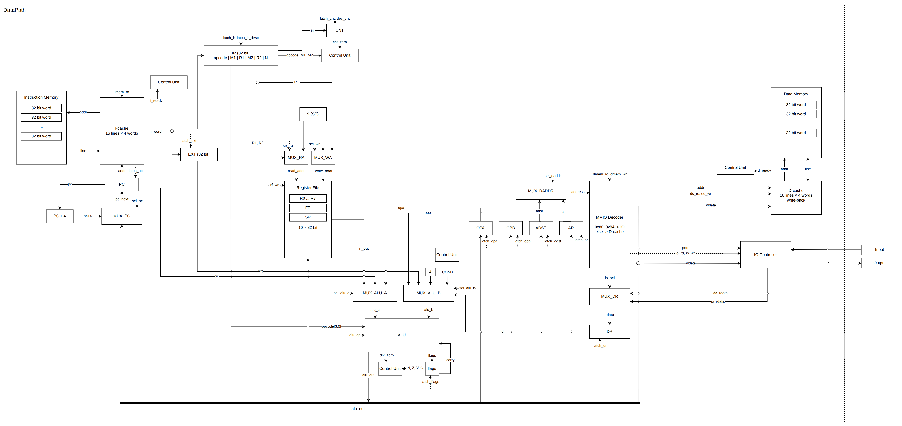
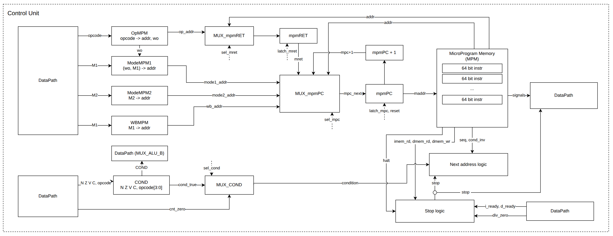

# Модель процессора

Процессор состоит из тракта данных (DataPath), микропрограммного устройства управления (Control Unit), двух кешей (I-cache и D-cache), памяти команд, памяти данных и контроллера ввода-вывода. Каждый такт Control Unit выдаёт одну микрокоманду, биты которой служат управляющими сигналами DataPath.

Схема в формате draw.io: [scheme-cisc.drawio](scheme-cisc.drawio). Названия блоков и сигналов в этом документе и в коде модели совпадают с названиями на схеме.

## DataPath



Сплошные линии на схеме это данные и адреса, пунктирные стрелки это управляющие сигналы от Control Unit. Блоки с подписью `Control Unit` показывают, какие значения уходят в устройство управления.

### Регистры

| Регистр      | Разрядность | Назначение                                                         | Сигнал записи          |
|--------------|-------------|--------------------------------------------------------------------|------------------------|
| `PC`         | 32          | адрес текущего слова в памяти команд                               | `latch_pc`             |
| `IR`         | 32          | первое слово команды, поля `opcode`, `M1`, `R1`, `M2`, `R2`, `N`   | `latch_ir`             |
| `IR.M1 R1`   | 8           | поле первого операнда, отдельно загружается из слова-описателя операнда `push` и `pop` | `latch_ir_desc` |
| `EXT`        | 32          | последнее прочитанное слово расширения                             | `latch_ext`            |
| `Register File` | 10 × 32  | регистры `R0`..`R7`, `FP`, `SP`, один порт чтения и один порт записи | `rf_wr`              |
| `OPA`        | 32          | значение первого операнда, затем результат операции                | `latch_opa`            |
| `OPB`        | 32          | значение второго операнда                                          | `latch_opb`            |
| `ADST`       | 32          | адрес первого операнда в памяти (адрес приёмника)                  | `latch_adst`           |
| `AR`         | 32          | адрес второго операнда в памяти и адрес вершины стека              | `latch_ar`             |
| `DR`         | 32          | слово, прочитанное из памяти данных или из порта ввода             | `latch_dr`             |
| `flags`      | 4           | флаги `N Z V C`                                                    | `latch_flags`          |
| `CNT`        | 8           | счётчик оставшихся операндов `push` и `pop`                        | `latch_cnt`, `dec_cnt` |

Регистры `IR`, `EXT`, `OPA`, `OPB`, `ADST`, `AR`, `DR`, `CNT` внутренние, программисту они недоступны.

Слово `i_word` из кеша команд приходит на вход `IR` и `EXT` по одной линии. Сигнал `latch_ir` записывает в `IR` всё слово. Сигнал `latch_ir_desc` записывает только биты 23..16, то есть поле `M1 R1`: так в регистр команды попадает описатель очередного операнда `push` или `pop`, а опкод и остальные поля сохраняются. Отдельный мультиплексор для этого не нужен, потому что в описателе режим и регистр стоят в тех же битах, что `M1` и `R1` в первом слове команды.

Первый операнд всегда адресуется через `ADST`, второй через `AR`. Поэтому адрес приёмника сохраняется, пока читается второй операнд, и результат записывается по нему без повторного вычисления.

### Мультиплексоры

| Мультиплексор | Сигнал       | Входы                                                      | Выход                                      |
|---------------|--------------|------------------------------------------------------------|--------------------------------------------|
| `MUX_PC`      | `sel_pc`     | 0: `pc+4`, 1: `alu_out`                                    | `pc_next`, вход `PC`                       |
| `MUX_RA`      | `sel_ra`     | 0: `IR.R1`, 1: `IR.R2`, 2: константа `9` (`SP`)            | `read_addr`, номер регистра для чтения     |
| `MUX_WA`      | `sel_wa`     | 0: `IR.R1`, 1: константа `9` (`SP`)                        | `write_addr`, номер регистра для записи    |
| `MUX_ALU_A`   | `sel_alu_a`  | 0: `rf_out`, 1: `opa`, 2: `pc`                             | `alu_a`, вход A АЛУ                        |
| `MUX_ALU_B`   | `sel_alu_b`  | 0: `opb`, 1: `ext`, 2: `dr`, 3: константа `4`, 4: `COND`   | `alu_b`, вход B АЛУ                        |
| `MUX_DADDR`   | `sel_daddr`  | 0: `ar`, 1: `adst`                                         | `address`, адрес памяти данных             |
| `MUX_DR`      | `io_sel`     | 0: `dc_rdata` (D-cache), 1: `io_rdata` (порт ввода)        | `rdata`, вход `DR`                         |

`COND` это однобитный выход блока условий Control Unit, дополненный нулями до 32 бит. Он нужен командам `seq`..`sge`. Сигнал `io_sel` вырабатывает не Control Unit, а MMIO Decoder (см. ниже).

### АЛУ

АЛУ комбинационное: результат и флаги появляются на выходе в том же такте. Операция задаётся полем `alu_op` микрокоманды:

| `alu_op` | Операция     | `alu_op` | Операция                     |
|----------|--------------|----------|------------------------------|
| 0x0      | `A + B`      | 0x8      | `A - B - C`                  |
| 0x1      | `A - B`      | 0x9      | `A - B` (для `cmp`)          |
| 0x2      | `A * B`      | 0xA      | `-A`                         |
| 0x3      | `A / B`      | 0xB      | `~A`                         |
| 0x4      | `A % B`      | 0xC      | `A` (пропустить A)           |
| 0x5      | `A & B`      | 0xD      | `B` (пропустить B)           |
| 0x6      | `A \| B`     | 0xF      | операция из `IR.opcode[3:0]` |
| 0x7      | `A + B + C`  |          |                              |

Коды `0x0`..`0xB` совпадают с младшими четырьмя битами опкодов `add`..`not` (`0x10`..`0x1B`). Благодаря этому все арифметические команды выполняются одной микрокомандой с `alu_op = 0xF`: АЛУ само берёт операцию из регистра команды. Значение флага `C` для операций с переносом приходит из регистра `flags` по линии `carry`.

Выход АЛУ `alu_out` это общая шина. К ней подключены входы `PC` (через `MUX_PC`), порт записи `Register File`, регистры `OPA`, `OPB`, `ADST`, `AR` и вход данных записи `wdata` (D-cache и контроллер ввода-вывода). Какой из приёмников запомнит значение, определяют сигналы `latch_*`, `rf_wr` и `dmem_wr`.

Деление на ноль выставляет сигнал `div_zero`, который поступает в Control Unit и останавливает процессор с ошибкой.

### Память команд и I-cache

Адрес памяти команд всегда берётся из `PC`. Чтение выполняется сигналом `imem_rd` через I-cache. Прочитанное слово `i_word` подаётся на входы `IR` и `EXT`. I-cache выдаёт в Control Unit сигнал готовности `i_ready`.

### Память данных, D-cache и ввод-вывод

Адрес `address` с `MUX_DADDR` поступает на адресный дешифратор MMIO Decoder. Сигналы от Control Unit: `dmem_rd` (чтение) и `dmem_wr` (запись). Дешифратор по адресу сам вырабатывает сигналы для выбранного устройства:

| Адрес              | Сигналы дешифратора                     | Источник данных для `DR` (`io_sel`) |
|--------------------|-----------------------------------------|-------------------------------------|
| `0x80`, `0x84`     | `io_rd`, `io_wr` для IO Controller      | 1: `io_rdata` (порт ввода)          |
| остальные          | `dc_rd`, `dc_wr` для D-cache            | 0: `dc_rdata` (D-cache)             |

Control Unit, таким образом, не различает память и порты: микрокоманды обращаются к памяти данных одинаково, а направление обращения выбирает дешифратор. Это и есть отображение портов в память (вариант `mem`).

Данные для записи `wdata` берутся с шины `alu_out`. Прочитанное слово (из D-cache или из порта ввода) проходит через `MUX_DR` и записывается в `DR`. D-cache выдаёт сигнал готовности `d_ready`. При обращении к портам ожидания нет: контроллер ввода-вывода отвечает в том же такте.

IO Controller при чтении порта `0x80` берёт очередной символ из буфера `Input`, при записи в порт `0x84` добавляет младший байт слова в буфер `Output`.

## Control Unit



Блоки с подписью `DataPath` показывают, откуда приходят значения из тракта данных и куда уходят управляющие сигналы.

### Состав

| Элемент              | Назначение                                                                 |
|----------------------|----------------------------------------------------------------------------|
| `MPM`                | MicroProgram Memory, память микропрограмм: 256 слов по 64 бита (используется 45 бит) |
| `mpmPC`              | адрес текущей микрокоманды                                                 |
| `mpmRET`             | адрес возврата из микроподпрограммы                                        |
| `OpMPM`              | таблица по опкоду: адрес микропрограммы выполнения `op_addr` и бит `wo`    |
| `ModeMPM1`           | таблица по `(wo, IR.M1)`: адрес подпрограммы выборки первого операнда `mode1_addr` |
| `ModeMPM2`           | таблица по `IR.M2`: адрес подпрограммы выборки второго операнда `mode2_addr` |
| `WBMPM`              | таблица по `IR.M1`: адрес подпрограммы записи результата `wb_addr`         |
| `COND`               | блок условий: по флагам и `IR.opcode[3:0]` выдаёт истинность условия команды `cond_true` |
| `MUX_COND`           | выбор условия микроперехода (`sel_cond`): 0: `cond_true`, 1: `cnt_zero`    |
| `MUX_mpmPC`          | выбор следующего адреса микрокоманды (`sel_mpc`)                           |
| `MUX_mpmRET`         | выбор адреса возврата (`sel_mret`): `op_addr` из `OpMPM` или поле `addr`   |
| `Next address logic` | по полям `seq`, `cond_inv` и условию `condition` вырабатывает `sel_mpc`, `latch_mpc`, `sel_mret`, `latch_mret` |
| `Stop logic`         | выставляет сигнал `stop`, пока кеш не готов                                |

Бит `wo` (write only) в `OpMPM` означает, что первый операнд команды служит только приёмником, и его значение читать не нужно: вычисляется только адрес. Это команды `mov`, `seq`..`sge` и операнды `pop`.

Блок условий `COND` вычисляет условие по коду в младших битах опкода:

| `opcode[3:0]` | 0      | 1   | 2    | 3     | 4            | 5            | 6     | 7   | 8    |
|---------------|--------|-----|------|-------|--------------|--------------|-------|-----|------|
| условие       | всегда | `Z` | `!Z` | `N≠V` | `Z \| N≠V`   | `!Z & N=V`   | `N=V` | `C` | `!C` |

Младшие биты опкодов переходов `jmp`..`jcc` (`0x20`..`0x28`) и команд установки `seq`..`sge` (`0x31`..`0x36`) совпадают с этими кодами. Поэтому все переходы выполняются одной микропрограммой, а все команды установки другой.

### Выбор следующей микрокоманды

Поле `seq` микрокоманды определяет следующий `mpmPC`:

| `seq` | Название | Следующий `mpmPC`                                     | Действие с `mpmRET`       |
|-------|----------|-------------------------------------------------------|---------------------------|
| 0     | `NEXT`   | `mpmPC + 1`                                           | нет                       |
| 1     | `JMP`    | `addr`                                                | нет                       |
| 2     | `BR`     | `addr`, если условие истинно, иначе `mpmPC + 1`       | нет                       |
| 3     | `DECODE` | `ModeMPM1[wo, IR.M1]`                                 | `mpmRET ← OpMPM[opcode]`  |
| 4     | `OP2`    | `ModeMPM2[IR.M2]`                                     | нет                       |
| 5     | `CALL1`  | `ModeMPM1[wo, IR.M1]`                                 | `mpmRET ← addr`           |
| 6     | `WB`     | `WBMPM[IR.M1]`                                        | `mpmRET ← addr`           |
| 7     | `RET`    | `mpmRET`                                              | нет                       |

Условие для `BR` выбирает `MUX_COND` (поле `sel_cond`), поле `cond_inv` его инвертирует.

Выполнение любой команды проходит одну и ту же цепочку:

```text
FETCH → DECODE → выборка 1-го операнда → OP2 → выборка 2-го операнда → RET → выполнение → (WB → запись результата → RET) → FETCH
```

Подпрограммы выборки операндов общие для всех команд. Поэтому каждый режим адресации реализован в микрокоде один раз, а не отдельно для каждой команды.

### Ожидание кеша и останов

Если микрокоманда обращается к памяти (`imem_rd`, `dmem_rd` или `dmem_wr`), а соответствующий кеш ещё не готов (`i_ready = 0` или `d_ready = 0`), блок Stop logic выставляет сигнал `stop`. Он блокирует в DataPath все сигналы `latch_*`, `rf_wr` и `dec_cnt`, а в Next address logic запись `mpmPC` и `mpmRET`. Микрокоманда повторяется в следующем такте, пока кеш не выставит готовность. Так ожидание памяти видно в журнале потактово.

Окончательно процессор останавливают бит `halt` микрокоманды (команда `halt` или недопустимая команда) и сигнал `div_zero` от АЛУ: после них такты больше не выполняются. На схеме эти две линии не показаны.

## Формат микрокоманды

Микрокоманда горизонтальная: каждый сигнал или поле выбора мультиплексора занимает отдельные биты.

| Биты  | Поле            | Ширина | Значения                                               |
|-------|-----------------|--------|--------------------------------------------------------|
| 0..1  | `sel_ra`        | 2      | 0: `R1`, 1: `R2`, 2: `SP`                              |
| 2..3  | `sel_alu_a`     | 2      | 0: `rf_out`, 1: `opa`, 2: `pc`                         |
| 4..6  | `sel_alu_b`     | 3      | 0: `opb`, 1: `ext`, 2: `dr`, 3: `4`, 4: `COND`         |
| 7..10 | `alu_op`        | 4      | см. таблицу АЛУ                                        |
| 11    | `sel_pc`        | 1      | 0: `pc+4`, 1: `alu_out`                                |
| 12    | `sel_wa`        | 1      | 0: `R1`, 1: `SP`                                       |
| 13    | `sel_daddr`     | 1      | 0: `ar`, 1: `adst`                                     |
| 14    | `latch_pc`      | 1      |                                                        |
| 15    | `latch_ir`      | 1      |                                                        |
| 16    | `latch_ir_desc` | 1      | записать только поле `M1 R1`                           |
| 17    | `latch_ext`     | 1      |                                                        |
| 18    | `latch_opa`     | 1      |                                                        |
| 19    | `latch_opb`     | 1      |                                                        |
| 20    | `latch_adst`    | 1      |                                                        |
| 21    | `latch_ar`      | 1      |                                                        |
| 22    | `latch_dr`      | 1      |                                                        |
| 23    | `latch_flags`   | 1      |                                                        |
| 24    | `latch_cnt`     | 1      | `CNT ← IR.N`                                           |
| 25    | `dec_cnt`       | 1      | `CNT ← CNT - 1`                                        |
| 26    | `rf_wr`         | 1      | запись в регистр с номером `write_addr`                |
| 27    | `imem_rd`       | 1      | чтение памяти команд по `PC`                           |
| 28    | `dmem_rd`       | 1      | чтение памяти данных                                   |
| 29    | `dmem_wr`       | 1      | запись в память данных                                 |
| 30    | `halt`          | 1      | останов процессора                                     |
| 31..33 | `seq`          | 3      | см. таблицу выбора следующей микрокоманды              |
| 34..35 | `sel_cond`     | 2      | 0: `cond_true`, 1: `cnt_zero`                          |
| 36    | `cond_inv`      | 1      | инвертировать условие                                  |
| 37..44 | `addr`         | 8      | адрес перехода или возврата                            |

## Микропрограмма

Запись `X ← Y` означает: АЛУ пропускает или вычисляет `Y`, и регистр `X` защёлкивает результат. `mem[...]` это обращение к памяти данных, `IMem[PC]` к памяти команд.

| Адрес | Метка       | Микрооперации                                         | Переход                   |
|-------|-------------|-------------------------------------------------------|---------------------------|
| 0     | `FETCH`     | `IR ← IMem[PC]`, `PC ← PC + 4`                        | `NEXT`                    |
| 1     | `DECODE`    | `CNT ← IR.N`                                          | `DECODE`                  |
| 2     | `O1_NONE`   | нет                                                   | `OP2`                     |
| 3     | `O1R_REG`   | `OPA ← RF[R1]`                                        | `OP2`                     |
| 4     | `O1R_IMM`   | `EXT ← IMem[PC]`, `PC ← PC + 4`                       | `NEXT`                    |
| 5     |             | `OPA ← EXT`                                           | `OP2`                     |
| 6     | `O1R_ABS`   | `EXT ← IMem[PC]`, `PC ← PC + 4`                       | `NEXT`                    |
| 7     |             | `ADST ← EXT`                                          | `JMP 11`                  |
| 8     | `O1R_OFF`   | `EXT ← IMem[PC]`, `PC ← PC + 4`                       | `NEXT`                    |
| 9     |             | `ADST ← RF[R1] + EXT`                                 | `JMP 11`                  |
| 10    | `O1R_IND`   | `ADST ← RF[R1]`                                       | `NEXT`                    |
| 11    | `O1R_MEM`   | `DR ← mem[ADST]`                                      | `NEXT`                    |
| 12    |             | `OPA ← DR`                                            | `OP2`                     |
| 13    | `O1W_ABS`   | `EXT ← IMem[PC]`, `PC ← PC + 4`                       | `NEXT`                    |
| 14    |             | `ADST ← EXT`                                          | `OP2`                     |
| 15    | `O1W_OFF`   | `EXT ← IMem[PC]`, `PC ← PC + 4`                       | `NEXT`                    |
| 16    |             | `ADST ← RF[R1] + EXT`                                 | `OP2`                     |
| 17    | `O1W_IND`   | `ADST ← RF[R1]`                                       | `OP2`                     |
| 18    | `O2_NONE`   | нет                                                   | `RET`                     |
| 19    | `O2_REG`    | `OPB ← RF[R2]`                                        | `RET`                     |
| 20    | `O2_IMM`    | `EXT ← IMem[PC]`, `PC ← PC + 4`                       | `NEXT`                    |
| 21    |             | `OPB ← EXT`                                           | `RET`                     |
| 22    | `O2_ABS`    | `EXT ← IMem[PC]`, `PC ← PC + 4`                       | `NEXT`                    |
| 23    |             | `AR ← EXT`                                            | `JMP 27`                  |
| 24    | `O2_OFF`    | `EXT ← IMem[PC]`, `PC ← PC + 4`                       | `NEXT`                    |
| 25    |             | `AR ← RF[R2] + EXT`                                   | `JMP 27`                  |
| 26    | `O2_IND`    | `AR ← RF[R2]`                                         | `NEXT`                    |
| 27    | `O2_MEM`    | `DR ← mem[AR]`                                        | `NEXT`                    |
| 28    |             | `OPB ← DR`                                            | `RET`                     |
| 29    | `WB_REG`    | `RF[R1] ← OPA`                                        | `RET`                     |
| 30    | `WB_MEM`    | `mem[ADST] ← OPA`                                     | `RET`                     |
| 31    | `EX_ALU`    | `OPA ← OPA op OPB` (`alu_op = 0xF`), `flags`          | `WB`, `addr = 0`          |
| 32    | `EX_CMP`    | `OPA op OPB` (`alu_op = 0xF`), только `flags`         | `JMP 0`                   |
| 33    | `EX_MOV`    | `OPA ← OPB`                                           | `WB`, `addr = 0`          |
| 34    | `EX_SET`    | `OPA ← COND`                                          | `WB`, `addr = 0`          |
| 35    | `EX_JCC`    | нет                                                   | `BR` (не `cond_true`) → 0 |
| 36    |             | `PC ← OPA`                                            | `JMP 0`                   |
| 37    | `EX_CALL`   | `SP ← SP - 4`, `AR ← SP - 4`                          | `NEXT`                    |
| 38    |             | `mem[AR] ← PC`                                        | `NEXT`                    |
| 39    |             | `PC ← OPA`                                            | `JMP 0`                   |
| 40    | `EX_RET`    | `AR ← SP`                                             | `NEXT`                    |
| 41    |             | `DR ← mem[AR]`, `SP ← SP + 4`                         | `NEXT`                    |
| 42    |             | `PC ← DR`                                             | `JMP 0`                   |
| 43    | `EX_PUSH`   | `IR.M1 R1 ← IMem[PC]`, `PC ← PC + 4`, `CNT ← CNT - 1` | `NEXT`                    |
| 44    |             | `SP ← SP - 4`, `AR ← SP - 4`                          | `CALL1`, `addr = 45`      |
| 45    |             | `mem[AR] ← OPA`                                       | `BR` (не `cnt_zero`) → 43 |
| 46    |             | нет                                                   | `JMP 0`                   |
| 47    | `EX_POP`    | `IR.M1 R1 ← IMem[PC]`, `PC ← PC + 4`, `CNT ← CNT - 1` | `NEXT`                    |
| 48    |             | `AR ← SP`                                             | `CALL1`, `addr = 49`      |
| 49    |             | `DR ← mem[AR]`, `SP ← SP + 4`                         | `NEXT`                    |
| 50    |             | `OPA ← DR`                                            | `WB`, `addr = 51`         |
| 51    |             | нет                                                   | `BR` (не `cnt_zero`) → 47 |
| 52    |             | нет                                                   | `JMP 0`                   |
| 53    | `EX_HALT`   | `halt`                                                | нет                       |
| 54    | `ERROR`     | `halt` (недопустимый опкод или режим адресации)       | нет                       |

В микрокомандах `41` и `49` чтение памяти и изменение `SP` выполняются в одном такте: память работает с адресом из `AR`, а АЛУ в это время свободно.

### Таблицы переходов

`OpMPM` (для всех остальных опкодов адрес `ERROR`):

| Опкоды                          | Команды                     | Адрес        | `wo` |
|---------------------------------|-----------------------------|--------------|------|
| `0x00`                          | `halt`                      | 53 `EX_HALT` | 0    |
| `0x01`                          | `mov`                       | 33 `EX_MOV`  | 1    |
| `0x02`                          | `push`                      | 43 `EX_PUSH` | 0    |
| `0x03`                          | `pop`                       | 47 `EX_POP`  | 1    |
| `0x10`..`0x18`, `0x1A`, `0x1B`  | `add`..`sbc`, `neg`, `not`  | 31 `EX_ALU`  | 0    |
| `0x19`                          | `cmp`                       | 32 `EX_CMP`  | 0    |
| `0x20`..`0x28`                  | `jmp`..`jcc`                | 35 `EX_JCC`  | 0    |
| `0x31`..`0x36`                  | `seq`..`sge`                | 34 `EX_SET`  | 1    |
| `0x40`                          | `call`                      | 37 `EX_CALL` | 0    |
| `0x41`                          | `ret`                       | 40 `EX_RET`  | 0    |

`ModeMPM1`, `ModeMPM2`, `WBMPM` (по коду режима адресации, для несуществующих режимов адрес `ERROR`):

| Режим        | `ModeMPM1`, `wo = 0` | `ModeMPM1`, `wo = 1` | `ModeMPM2`   | `WBMPM`     |
|--------------|----------------------|----------------------|--------------|-------------|
| 0 нет        | 2 `O1_NONE`          | 2 `O1_NONE`          | 18 `O2_NONE` | 54 `ERROR`  |
| 1 `Rn`       | 3 `O1R_REG`          | 2 `O1_NONE`          | 19 `O2_REG`  | 29 `WB_REG` |
| 2 `#v`       | 4 `O1R_IMM`          | 54 `ERROR`           | 20 `O2_IMM`  | 54 `ERROR`  |
| 3 `[addr]`   | 6 `O1R_ABS`          | 13 `O1W_ABS`         | 22 `O2_ABS`  | 30 `WB_MEM` |
| 4 `[Rn]`     | 10 `O1R_IND`         | 17 `O1W_IND`         | 26 `O2_IND`  | 30 `WB_MEM` |
| 5 `[Rn+off]` | 8 `O1R_OFF`          | 15 `O1W_OFF`         | 24 `O2_OFF`  | 30 `WB_MEM` |

У команд `push` и `pop` в первом слове `M1 = M2 = 0`, поэтому при декодировании выборка операндов пропускается. Для каждого операнда микропрограмма загружает его описатель в поле `IR.M1 R1` (сигнал `latch_ir_desc`) и вызывает ту же подпрограмму выборки первого операнда через `CALL1`. Поле `IR.M2` остаётся равным нулю, поэтому после выборки управление через `O2_NONE` возвращается в цикл `push` или `pop`.

## Пример выполнения: `add [FP-4], #1`

Слова команды: `10582000 FFFFFFFC 00000001` (опкод `0x10`, `M1 = 5`, `R1 = 8` (`FP`), `M2 = 2`). Все обращения к памяти попадают в кеш.

| Такт | `mpmPC` | Что происходит                                                    |
|------|---------|-------------------------------------------------------------------|
| 1    | 0       | `IR ← 10582000`, `PC ← PC + 4`                                    |
| 2    | 1       | `mpmRET ← OpMPM[0x10] = 31`, `mpmPC ← ModeMPM1[0, 5] = 8`         |
| 3    | 8       | `EXT ← FFFFFFFC` (−4), `PC ← PC + 4`                              |
| 4    | 9       | `ADST ← FP + (−4)`                                                |
| 5    | 11      | `DR ← mem[ADST]` (текущее значение переменной)                    |
| 6    | 12      | `OPA ← DR`, `mpmPC ← ModeMPM2[2] = 20`                            |
| 7    | 20      | `EXT ← 00000001`, `PC ← PC + 4`                                   |
| 8    | 21      | `OPB ← 1`, `mpmPC ← mpmRET = 31`                                  |
| 9    | 31      | `OPA ← OPA + OPB`, флаги, `mpmRET ← 0`, `mpmPC ← WBMPM[5] = 30`   |
| 10   | 30      | `mem[ADST] ← OPA`, `mpmPC ← mpmRET = 0`                           |

Итого 10 тактов.

## Количество тактов

Каждая микрокоманда выполняется за один такт (при попадании в кеш). Время выполнения команды:

```text
T = 2 + T1 + T2 + Tвып
```

где 2 это такты `FETCH` и `DECODE`, `T1` и `T2` это выборка первого и второго операндов, `Tвып` это выполнение.

| Режим        | `T1` (чтение) | `T1` (только адрес) | `T2` |
|--------------|---------------|---------------------|------|
| нет          | 1             | 1                   | 1    |
| `Rn`         | 1             | 1                   | 1    |
| `#v`         | 2             | недопустим          | 2    |
| `[addr]`     | 4             | 2                   | 4    |
| `[Rn]`       | 3             | 1                   | 3    |
| `[Rn+off]`   | 4             | 2                   | 4    |

«Только адрес» используется для первого операнда команд `mov`, `seq`..`sge` и операндов `pop`.

| Команды                              | `Tвып`                                 | Пример                                           |
|--------------------------------------|----------------------------------------|--------------------------------------------------|
| `add`..`sbc`, `neg`, `not`           | 2                                      | `add R1, R2`: 6, `add [FP-4], #1`: 10            |
| `cmp`                                | 1                                      | `cmp [FP+8], #0`: 9                              |
| `mov`                                | 2                                      | `mov R1, R2`: 6, `mov [0x0084], #104`: 8         |
| `seq`..`sge`                         | 2                                      | `slt R1`: 6                                      |
| `jmp`..`jcc`                         | 1 (нет перехода), 2 (переход)          | `jeq #label`: 6 или 7                            |
| `call`                               | 3                                      | `call #f`: 8                                     |
| `ret`                                | 3                                      | 7                                                |
| `halt`                               | 1                                      | 5                                                |
| `push op1, ..., opN`                 | `Σ(4 + T1ᵢ) + 1`, `T1ᵢ` для чтения     | `push FP`: 10, `push R1, #5`: 16                 |
| `pop op1, ..., opN`                  | `Σ(7 + T1ᵢ) + 1`, `T1ᵢ` только адрес   | `pop FP`: 13                                     |

Каждое обращение к памяти, промахнувшееся мимо кеша, добавляет 9 тактов ожидания, а промах D-cache с вытеснением изменённой строки 19 тактов.

## Кеш

I-cache и D-cache устроены одинаково:

| Параметр                               | Значение                                                       |
|----------------------------------------|----------------------------------------------------------------|
| Организация                            | прямое отображение (direct-mapped)                             |
| Число строк                            | 16                                                             |
| Длина строки                           | 4 слова (16 байт)                                              |
| Разбиение адреса                       | биты 1..0: байт в слове, 3..2: слово в строке, 7..4: номер строки, 31..8: тег |
| Попадание                              | 1 такт                                                         |
| Промах                                 | 10 тактов: из памяти читается вся строка целиком               |
| Политика записи (D-cache)              | обратная запись (write-back) с размещением при записи (write-allocate) |
| Промах с вытеснением изменённой строки | 20 тактов: запись старой строки в память и чтение новой        |

Каждая строка хранит тег и бит достоверности (valid), а строка D-cache ещё и бит изменения (dirty). I-cache только читает.

Прямое отображение и обратная запись выбраны как компромисс: прямое отображение проще всего реализовать и объяснить, а обратная запись не делает каждую запись в память медленной. Поэтому эффект кеша хорошо виден на `linear_filter`.

Обращения к портам ввода-вывода идут мимо D-cache: адреса `0x80` и `0x84` MMIO Decoder перехватывает раньше. Порты лежат в одной строке кеша с первыми статическими данными (`0x88`, `0x8C`), и это не мешает: строка `0x80`..`0x8F` кешируется как обычная, а её слова `0x80` и `0x84` процессор через кеш никогда не читает (подробнее в [memory-isa.md](memory-isa.md)).

Модель можно запустить с флагом `--no-cache`: тогда кешей нет, и каждое обращение к памяти команд или данных занимает 10 тактов. Это нужно, чтобы измерить выигрыш от кеша.
